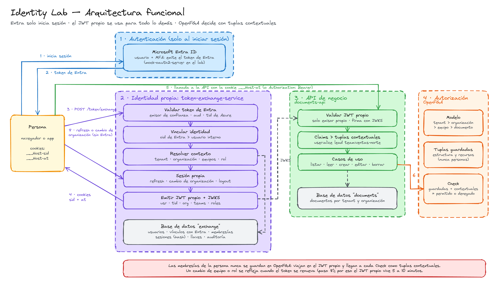
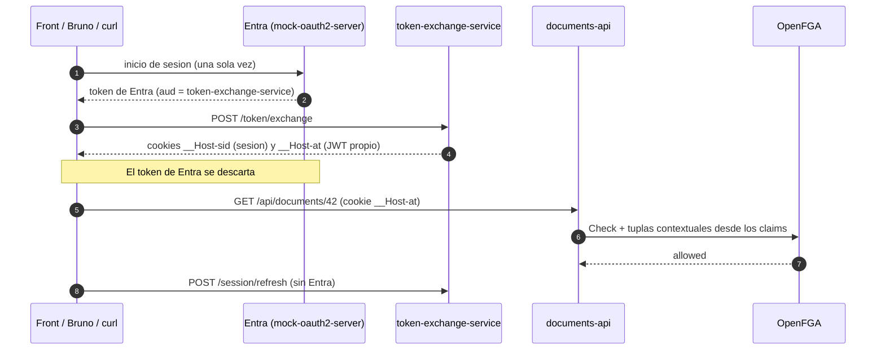

# Identity Lab

Laboratorio para entender la solucion de identidad y autorizacion:

**Entra ID solo inicia sesion → ese token pasa por el servicio propio de JWT exchange → el token propio (con claims de usuario, organizacion, equipos y rol) se usa para todo lo demas → cada API autoriza con OpenFGA usando esos claims como tuplas contextuales**, con la sesion en cookies.

Todo corre en local con Docker y herramientas gratuitas. Entra ID se simula con [mock-oauth2-server](https://github.com/navikt/mock-oauth2-server).

**¿Por dónde empiezo?** → [LEEME-PRIMERO.md](LEEME-PRIMERO.md) (orden de lectura)

| Documento | Para qué |
| --- | --- |
| [Guía local](docs/guia-local.md) | Instalar, configurar, correr y probar en tu máquina |
| [Pruebas con Bruno](docs/bruno.md) | El flujo petición por petición |
| [Glosario](docs/glosario.md) | OIDC, `iss`, `aud`, tuplas contextuales, `__Host-`… |

## Arquitectura funcional



El diagrama es editable: abre [`docs/arquitectura-funcional.excalidraw`](docs/arquitectura-funcional.excalidraw) en [excalidraw.com](https://excalidraw.com) (menú → Abrir).

## Secuencia



## Componentes

| Componente | Puerto | Que hace |
| --- | --- | --- |
| `proxy` (Caddy) | 80 | Pone front y APIs bajo `http://localhost` para que viajen las cookies |
| `mock-entra` | 8090 | Hace de Entra ID: OIDC, pantalla de login, claims `oid`, `tid`, `aud` |
| `token-exchange-service` | 8082 | **El servicio propio**: valida el token de Entra, crea la sesion, emite el JWT propio |
| `documents-api` | 8081 | API de ejemplo: solo acepta el JWT propio y autoriza con OpenFGA |
| `openfga` | 8080 / 3000 | Autorizacion. Playground en http://localhost:3000 |
| `postgres` | 5432 | Bases `exchange`, `documents` y `openfga` |

## Arquitectura limpia (Scaffold Clean Architecture de Bancolombia)

Cada servicio es un proyecto del scaffold `co.com.bancolombia.cleanArchitecture` **5.0.2**, Gradle, **Java 25**, Spring MVC (`reactive=false`). El plugin trae la version de Spring Boot.

```
token-exchange-service/
├── applications/app-service          # MainApplication, UseCasesConfig, DomainConfig, application.yaml
├── domain/model                      # Entidades y gateways (interfaces). Java puro, sin Spring
│   └── co/com/lab/model/{user,accesscontext,identity,token,session,audit,exception}
├── domain/usecase                    # Casos de uso. Java puro
│   └── co/com/lab/usecase/{tokenexchange,session,signingkey,token}
├── infrastructure/driven-adapters
│   ├── jdbc-repository               # Postgres + Flyway: usuarios, membresias, sesiones, auditoria
│   ├── internal-jwt-adapter          # Firma y valida el JWT propio (Nimbus), llaves y JWKS
│   └── entra-token-adapter           # Valida el token de Entra contra trusted_issuers
├── infrastructure/entry-points/api-rest   # Controladores, cookies, CSRF, manejo de errores
└── deployment/Dockerfile

documents-api/
├── applications/app-service
├── domain/model                      # Document, Principal (+ tuplas contextuales), Relationship, gateways
├── domain/usecase                    # List/Get/Create/Update/DeleteDocumentUseCase
├── infrastructure/driven-adapters
│   ├── jdbc-repository               # Documentos en Postgres
│   └── openfga-adapter               # Check con tuplas contextuales, escritura de tuplas, bootstrap
└── infrastructure/entry-points/api-rest   # Resource server (JWT por cookie o Bearer), controladores
```

Las dependencias apuntan siempre hacia el dominio: `entry-points` y `driven-adapters` dependen de `model`/`usecase`, nunca al reves. Los casos de uso no llevan anotaciones de Spring; `UseCasesConfig` los registra por nombre (`.*UseCase`), como en el scaffold.

Para que el repo sea publico se usan Gradle Plugin Portal y Maven Central. En el banco se cambian los repositorios por Artifactory en `settings.gradle` y `build.gradle`.

## Herramientas

| Herramienta | Para que | Obligatoria |
| --- | --- | --- |
| Docker Desktop / Colima / Rancher Desktop + Compose | Levantar todo | Si |
| JDK 25 (Temurin) y Gradle 9 | Compilar y probar fuera de Docker | Para desarrollar |
| IntelliJ IDEA | IDE y cliente HTTP (`http/lab.http`) | Recomendada |
| `curl` y `jq` | Script de pruebas `scripts/e2e.sh` | Para el e2e |
| OpenFGA CLI (`fga`) | `fga model test` | Recomendada |
| DBeaver o `psql` | Ver tablas y sesiones | Opcional |

## Arrancar

Resumen rápido; el detalle, la configuración local, el modo de desarrollo con IntelliJ y la solución de problemas están en la [guía paso a paso](docs/guia-local.md).

```bash
docker compose up --build -d
```

La primera vez tarda (descarga imagenes y dependencias de Gradle). Cuando `documents-api` imprima `OpenFGA listo`, abre:

- http://localhost — front minimo: inicia sesion en el mock con usuario `alice`, `bob`, `carol` o `dave`.
- http://localhost:3000 — Playground de OpenFGA.
- `http/lab.http` en IntelliJ o la colección `bruno/` en [Bruno](docs/bruno.md) — el flujo paso a paso.

Empezar de cero (borra bases y store de OpenFGA): `docker compose down -v`.

## Pruebas

```bash
# Dominio y casos de uso (sin Spring ni base de datos)
cd token-exchange-service && gradle test
cd documents-api && gradle test

# Modelo de OpenFGA
fga model test --tests openfga/store.fga.yaml

# De punta a punta, con todo levantado
./scripts/e2e.sh
```

El e2e cubre: token de Entra rechazado por las APIs, otra audiencia, emisor y tenant de Azure no confiables, identidad sin vinculo, organizacion ajena, permisos por equipo y organizacion, cambio de organizacion, cambio de membresia reflejado al renovar, refresh con Entra apagado, token alterado, CSRF, reuso de sesion robada, inactividad y exchange servicio a servicio con `act`.

## Datos de prueba

| Persona | Organizacion (rol) | Equipos (rol) |
| --- | --- | --- |
| alice | acme-ventas (member), acme-marketing (member) | acme-ventas-norte (lead), acme-ventas-sur (member) |
| bob | acme-ventas (admin) | acme-ventas-sur (member) |
| carol | acme-marketing (admin) | — |
| dave | acme-ventas (member) | — |
| mallory | existe en Entra pero no tiene usuario interno | — |

Documentos: `42` (equipo norte), `43` (equipo sur, de bob), `44` (toda acme-ventas), `77` (acme-marketing).

## Claims del token propio

Propuesta mientras el equipo define los nombres definitivos (se cambian en `ClaimNames` y `JwtPrincipalMapper`):

```json
{
  "iss": "http://localhost/token",
  "sub": "alice",
  "usr": { "name": "Alice", "email": "alice@lab.local" },
  "aud": "documents-api",
  "tid": "acme",
  "org": { "id": "acme-ventas", "role": "member" },
  "teams": [ { "id": "acme-ventas-norte", "role": "lead" }, { "id": "acme-ventas-sur", "role": "member" } ],
  "roles": [],
  "idp": "http://localhost:8090/entra",
  "sid": "…",
  "token_use": "access",
  "cv": 1
}
```

Se convierten en tuplas contextuales (`Principal.membershipRelationships()`):
`user:alice member tenant:acme`, `user:alice member organization:acme-ventas`, `user:alice lead team:acme-ventas-norte`, `user:alice member team:acme-ventas-sur`.

## Pasar a Entra real

Sin tocar codigo: registra una app en Entra que exponga un scope para el exchange y agrega una fila en `trusted_issuers` con su `issuer`, `jwks_uri`, `audience` (App ID URI), `subject_claim = 'oid'` y `expected_tid` (tenant de Azure). Luego vincula los `oid` en `subject_links`.
