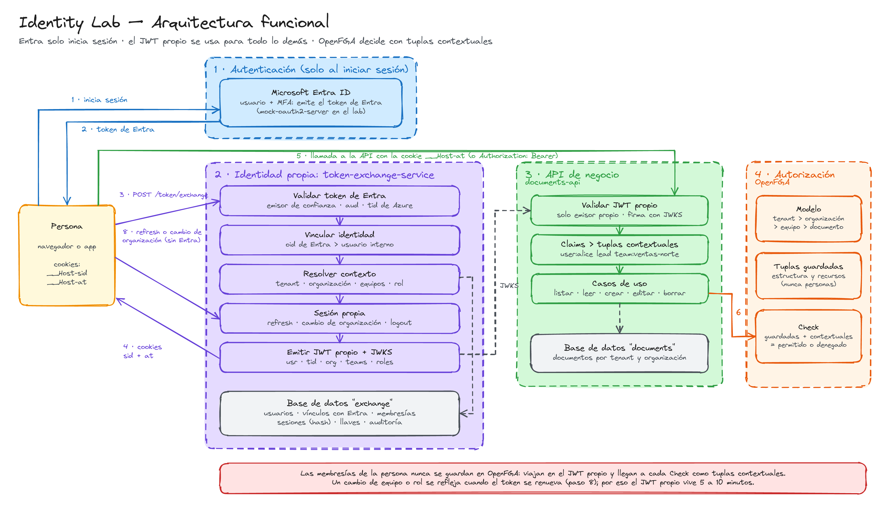

# Guía paso a paso: correr y probar el laboratorio en local

Esta guía va desde un equipo sin nada instalado hasta tener el flujo completo funcionando y probado:
**inicio de sesión en Entra (mock) → JWT exchange → llamadas a la API autorizadas por OpenFGA con tuplas contextuales**.



Hay dos formas de correrlo:

- **Modo A, todo en Docker.** Es la forma más rápida de ver todo funcionando y es la que usan las pruebas de punta a punta.
- **Modo B, desarrollo.** Docker levanta solo la infraestructura y los dos servicios Java corren en IntelliJ, para depurar con breakpoints.

---

## 1. Qué se va a levantar

| Servicio | URL en tu máquina | Para qué |
| --- | --- | --- |
| Proxy (Caddy) | http://localhost | Front y APIs bajo el mismo origen, para que viajen las cookies |
| Mock de Entra ID | http://localhost:8090/entra | Inicio de sesión (OIDC) |
| token-exchange-service | http://localhost:8082 (o vía proxy en `/token` y `/session`) | El servicio propio de JWT exchange |
| documents-api | http://localhost:8081 (o vía proxy en `/api`) | API de ejemplo autorizada con OpenFGA |
| OpenFGA API | http://localhost:8080 | Autorización |
| OpenFGA Playground | http://localhost:3000 | Ver el modelo y probar Checks a mano |
| PostgreSQL | localhost:5432 (`postgres` / `postgres`) | Bases `exchange`, `documents` y `openfga` |

---

## 2. Instalar las herramientas

Todas son gratuitas. Los comandos son para macOS con [Homebrew](https://brew.sh); en Windows usa WSL2 y los mismos comandos de Linux.

### 2.1 Docker

Elige una de estas opciones:

- **Colima** (gratis también en empresas):
  ```bash
  brew install colima docker docker-compose
  colima start --cpu 4 --memory 6
  ```
- **Docker Desktop**: gratis para uso personal; en empresas grandes requiere licencia, así que confirma con tu equipo antes de instalarlo en el portátil del trabajo.

Dale al menos **4 CPU y 6 GB de RAM**: se compilan dos proyectos Gradle dentro de Docker.

### 2.2 Java 25 y Gradle (para el modo B y las pruebas unitarias)

Con [SDKMAN](https://sdkman.io):

```bash
curl -s "https://get.sdkman.io" | bash
sdk install java 25-tem
sdk install gradle
```

### 2.3 Utilidades

```bash
brew install jq curl
brew install openfga/tap/fga      # CLI de OpenFGA
```

Además, **IntelliJ IDEA** (Community sirve). Trae el cliente HTTP que usa `http/lab.http`.

### 2.4 Verificar

```bash
docker version
docker compose version    # 2.24 o superior
java -version             # 25
gradle -v
jq --version
fga version
```

### 2.5 Puertos libres

Los puertos 80, 3000, 5432, 8080, 8081, 8082 y 8090 deben estar libres:

```bash
for p in 80 3000 5432 8080 8081 8082 8090; do lsof -nP -iTCP:$p -sTCP:LISTEN >/dev/null && echo "ocupado: $p"; done
```

Si tienes un Postgres local corriendo, detenlo (`brew services stop postgresql`) o cambia el puerto en `docker-compose.yml` (`"5433:5432"`).

---

## 3. Clonar y revisar la configuración

```bash
git clone https://github.com/acosta604/identity-lab.git
cd identity-lab
```

No hay que crear archivos `.env`. La configuración vive en:

| Archivo | Qué configura |
| --- | --- |
| `docker-compose.yml` | Servicios, puertos y variables de entorno de cada contenedor |
| `token-exchange-service/applications/app-service/src/main/resources/application.yaml` | Emisor del JWT propio, vida del token y de la sesión, cookies |
| `documents-api/applications/app-service/src/main/resources/application.yaml` | Emisor aceptado, JWKS, audiencia, conexión a OpenFGA |
| `infra/mock-entra/mock-entra.json` | Usuarios y claims que emite el mock de Entra |
| `token-exchange-service/.../db/migration/V2__seed.sql` | Emisores de confianza, usuarios, organizaciones, equipos y membresías |
| `openfga/model.fga` y `model.json` | Modelo de autorización (los dos deben decir lo mismo) |
| `openfga/seed-tuples.txt` | Tuplas guardadas: estructura y recursos |

Valores importantes:

| Propiedad | Valor | Por qué |
| --- | --- | --- |
| `lab.issuer` | `http://localhost/token` | El `iss` del JWT propio es la URL pública (vía proxy), no la del contenedor |
| `lab.access-token-ttl` | `10m` | El JWT propio vive poco; los cambios de membresía se ven al renovar |
| `lab.session-idle` / `lab.session-absolute` | `30m` / `12h` | Inactividad y vida máxima de la sesión propia |
| `lab.cookies-secure` | `true` | Cookies `__Host-`. Los navegadores aceptan `Secure` en `http://localhost` |

### En el portátil del banco

Si la red corporativa bloquea el Gradle Plugin Portal o Maven Central, cambia los repositorios por los de Artifactory, igual que en `ms_identity`:

- en `settings.gradle` → `pluginManagement { repositories { ... } }`
- en `build.gradle` → `allprojects { repositories { ... } }`

Si Docker no puede descargar imágenes de Docker Hub o `ghcr.io`, configura el proxy corporativo en Colima o Docker Desktop.

---

## 4. Modo A: todo en Docker

### 4.1 Levantar

```bash
docker compose up --build -d
```

La primera vez tarda varios minutos: descarga imágenes y las dependencias de Gradle de los dos servicios.

### 4.2 Esperar a que esté listo

```bash
docker compose ps
docker compose logs -f documents-api
```

Cuando veas `OpenFGA listo: store=... model=...`, presiona `Ctrl+C` (los contenedores siguen corriendo).

### 4.3 Comprobar cada pieza

```bash
curl -s http://localhost:8090/entra/.well-known/openid-configuration | jq .issuer     # mock de Entra
curl -s http://localhost/token/.well-known/jwks.json | jq '.keys[].kid'                # llaves del JWT propio
curl -s http://localhost:8082/actuator/health                                         # exchange
curl -s http://localhost:8081/actuator/health                                         # documents-api
curl -s http://localhost:8080/stores | jq '.stores[].name'                             # store de OpenFGA
```

Si alguna falla, revisa la sección 9.

---

## 5. Probar

### 5.1 Desde el navegador

1. Abre http://localhost y pulsa **Iniciar sesión**.
2. En la pantalla del mock de Entra escribe `alice` como usuario. En el campo de claims (opcional) pega lo siguiente, para que el token se parezca a uno de Entra emitido para el exchange, y entra:
   ```json
   {"aud": ["token-exchange-service"], "tid": "lab-azure-tenant"}
   ```
3. Vuelves al front. El token de Entra se usó una sola vez en `POST /token/exchange`; abre DevTools → Application → Cookies y verás `__Host-sid`, `__Host-at` y `XSRF-TOKEN`.
4. Pulsa **Ver claims y tuplas**: muestra los claims del JWT propio y las tuplas contextuales que salen de ellos.
5. Escribe `42` y pulsa **Editar**: 200, porque alice es `lead` del equipo norte.
6. Escribe `43` y pulsa **Editar**: 403, porque en el equipo sur solo es `member`.
7. Escribe `77` y pulsa **Leer**: 403, porque es de marketing.
8. Cambia la organización a `acme-marketing` y pulsa **Leer** otra vez: 200, sin volver a Entra.
9. Pulsa **Cerrar sesión** y prueba con `bob` (admin de ventas) o `dave` (miembro sin equipos).

### 5.2 Con IntelliJ

Abre `http/lab.http` y ejecuta las peticiones en orden. El cliente HTTP guarda las cookies entre peticiones, así que el flujo es el mismo que en el navegador. Cambia `client_id=alice` en la primera petición para probar otra persona.

### 5.3 A mano con curl (para ver cada paso)

```bash
# 1. "Iniciar sesión en Entra": token emitido para el servicio de exchange
ENTRA_TOKEN=$(curl -s -X POST http://localhost:8090/entra/token \
  -d grant_type=client_credentials -d client_id=alice -d client_secret=lab -d scope=token-exchange-service \
  | jq -r .access_token)

# Míralo: iss del mock, aud = token-exchange-service, oid, tid
cut -d. -f2 <<<"$ENTRA_TOKEN" | tr '_-' '/+' | base64 -d 2>/dev/null; echo

# 2. Exchange: guarda las cookies en alice.txt
curl -s -c alice.txt -X POST http://localhost/token/exchange \
  -d grant_type=urn:ietf:params:oauth:grant-type:token-exchange \
  -d subject_token="$ENTRA_TOKEN" \
  -d subject_token_type=urn:ietf:params:oauth:token-type:access_token \
  -d tenant=acme -d organization=acme-ventas | jq

# 3. Llamar a la API con la cookie (el token de Entra ya no se usa)
curl -s -b alice.txt http://localhost/api/whoami | jq
curl -s -b alice.txt http://localhost/api/documents | jq '.[].id'

# 4. Peticiones que cambian estado: con el header CSRF
XSRF=$(awk '$6=="XSRF-TOKEN"{print $7}' alice.txt)
curl -s -b alice.txt -c alice.txt -X PUT http://localhost/api/documents/42 \
  -H "X-XSRF-TOKEN: $XSRF" -H 'Content-Type: application/json' -d '{"title":"Plan Norte v2"}' | jq

# 5. Renovar el JWT propio sin Entra
curl -s -b alice.txt -c alice.txt -X POST http://localhost/session/refresh -H "X-XSRF-TOKEN: $XSRF" | jq
```

### 5.4 Pruebas de punta a punta

Con todo levantado:

```bash
./scripts/e2e.sh
```

Deben pasar todas. El script cubre los rechazos del exchange, los permisos por equipo y organización, el cambio de organización, los cambios de membresía, el refresh con Entra apagado, el CSRF, el reuso de una sesión robada, la inactividad y el exchange servicio a servicio.

Detiene y vuelve a iniciar `mock-entra` para comprobar que la sesión no depende de Entra, y modifica la base `exchange`. Si quieres volver a los datos iniciales, mira la sección 8.

### 5.5 Pruebas unitarias (dominio y casos de uso)

No necesitan Docker:

```bash
cd token-exchange-service && gradle test && cd ..
cd documents-api && gradle test && cd ..
```

### 5.6 Pruebas del modelo de OpenFGA

```bash
fga model test --tests openfga/store.fga.yaml
```

---

## 6. Observar qué está pasando

**Cada decisión de OpenFGA queda en el log** con sus tuplas contextuales:

```bash
docker compose logs -f documents-api | grep Check
# Check user:alice editor document:42 -> PERMITIDO | tuplas contextuales: [user:alice member tenant:acme, ...]
```

**Auditoría del exchange:**

```bash
docker compose logs -f token-exchange-service | grep audit
```

**Base de datos:**

```bash
docker compose exec postgres psql -U postgres -d exchange
```

```sql
select user_id, tenant_id, organization_id, last_seen_at, revoked_at from sessions order by created_at desc;
select at, result, user_id, organization_id, detail from exchange_audit order by id desc limit 20;
select * from team_memberships;
```

**Playground de OpenFGA:** abre http://localhost:3000, elige el store `identity-lab` y revisa el modelo y las tuplas guardadas. Ahí no vas a ver membresías de personas, porque llegan como tuplas contextuales en cada Check.

**Decodificar el JWT propio:**

```bash
AT=$(awk '$6=="__Host-at"{print $7}' alice.txt)
cut -d. -f2 <<<"$AT" | tr '_-' '/+' | base64 -d 2>/dev/null | jq
```

---

## 7. Modo B: desarrollo con IntelliJ

### 7.1 Levantar solo la infraestructura

```bash
docker compose -f docker-compose.yml -f docker-compose.local.yml \
  up -d postgres openfga-migrate openfga mock-entra proxy
```

El archivo `docker-compose.local.yml` hace que el proxy apunte a los servicios que corren en tu máquina (`host.docker.internal:8081` y `:8082`).

### 7.2 Abrir los proyectos

En IntelliJ, abre `token-exchange-service/` y `documents-api/` como proyectos Gradle; puedes hacerlo en dos ventanas o como módulos del mismo proyecto. Configura el SDK en Java 25.

### 7.3 Correr token-exchange-service

Run configuration de Spring Boot (o de aplicación) para `co.com.lab.MainApplication` del módulo `app-service`. Los valores por defecto de `application.yaml` ya apuntan a `localhost`, así que no necesita variables de entorno. Opcional: `LAB_ADMIN_ENABLED=true`.

Arráncalo una vez para que Flyway cree las tablas. Luego, como el servicio ya no está dentro de Docker, apunta el JWKS del mock a `localhost`:

```bash
docker compose exec postgres psql -U postgres -d exchange -c \
  "update trusted_issuers set jwks_uri = 'http://localhost:8090/entra/jwks'"
```

### 7.4 Correr documents-api

Mismo procedimiento con su `MainApplication`, pero con esta variable de entorno, que es la ruta a la carpeta `openfga/` del repo:

```
LAB_FGA_FILES_DIR=/ruta/a/identity-lab/openfga
```

Arranca primero token-exchange-service: documents-api lee su JWKS para validar el token.

### 7.5 Probar

Todo lo de la sección 5 funciona igual, incluido `./scripts/e2e.sh`. Pon breakpoints en:

- `TokenExchangeUseCase.execute` (exchange)
- `InternalJwtAdapter.claims` (armado de claims)
- `Principal.membershipRelationships` (claims a tuplas contextuales)
- `OpenFgaAuthorizationAdapter.isAllowed` (Check)

---

## 8. Reiniciar y limpiar

| Quieres… | Comando |
| --- | --- |
| Detener sin borrar datos | `docker compose stop` |
| Volver a levantar | `docker compose up -d` |
| Recompilar tras cambiar código | `docker compose up -d --build token-exchange-service documents-api` |
| Empezar de cero (borra bases y store de OpenFGA) | `docker compose down -v` y luego `docker compose up --build -d` |
| Cambiaste `model.fga` | Actualiza también `model.json` y haz `docker compose down -v` (el modelo solo se carga con un store nuevo) |

---

## 9. Problemas comunes

| Síntoma | Causa probable | Solución |
| --- | --- | --- |
| `port is already allocated` | Puerto ocupado | Sección 2.5 o cambia el puerto en `docker-compose.yml` |
| Falla la compilación en Docker descargando el plugin `co.com.bancolombia.cleanArchitecture` | Red corporativa | Usa Artifactory (sección 3) o compila fuera de la VPN |
| El exchange responde 401 `Token de Entra rechazado` | Token vencido, `aud` distinto o JWKS inalcanzable | Pide un token nuevo; en modo B revisa el `update trusted_issuers` (7.3) |
| documents-api responde 401 a todo | No alcanza el JWKS del exchange o el `iss` no coincide | El `iss` debe ser `http://localhost/token` en ambos servicios |
| 503 `OpenFGA aún no está listo` | documents-api arrancó antes que OpenFGA | Espera el log `OpenFGA listo` o reinicia documents-api |
| 403 `csrf` | Falta el header `X-XSRF-TOKEN` | Cópialo de la cookie `XSRF-TOKEN` en cada POST, PUT o DELETE |
| El navegador no guarda las cookies | Entraste por `127.0.0.1` o por el puerto del servicio | Entra siempre por `http://localhost` (el proxy) |
| curl no envía las cookies `__Host-` | Versión de curl antigua | Actualiza curl o pon `LAB_COOKIES_SECURE=false` en los dos servicios |
| Cambié un equipo en la base y el permiso no cambia | El JWT propio vigente aún trae el equipo anterior | Es el comportamiento esperado: `POST /session/refresh` |
| `fga model test` falla después de editar el modelo | `model.fga` y `model.json` no coinciden | `fga model transform --file openfga/model.fga > openfga/model.json` |
